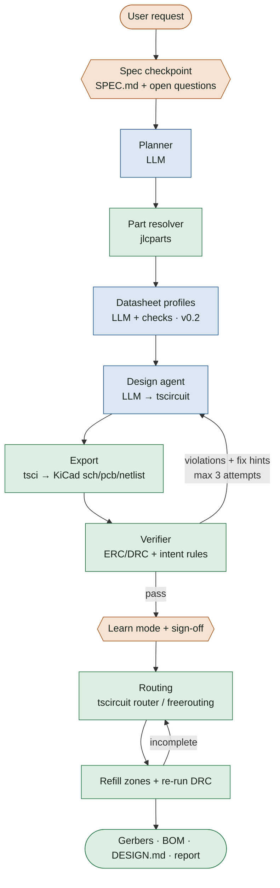

# reflow — System Design (v0.1)

> AI that designs your PCB, and won't let you ship one you don't understand.

Last updated: 2026-10-13 · Status: Weekend 2 of 3 · 2 intent rules built, 4 fixtures, 16/16 tests passing

---

## 1. What reflow is

An open-source agent that turns a one-sentence hardware request into **verified, manufacturable fab files**, while making sure the user understands the board.

Three ideas define it:

1. **Don't rebuild the EDA stack.** KiCad, tscircuit, freerouting and ngspice already exist. reflow is the orchestration and verification layer on top.
2. **Gate every board on intent verification.** Generating boards is solved. Catching plausible-but-wrong boards (a series decoupling cap, missing I²C pull-ups, a floating address pin) is not. KiCad ERC is silent on all of these.
3. **The user thinks, the AI works.** The AI plans, picks parts, draws, fixes and routes. The user confirms the spec, engages with mandatory interactive learn mode, and signs off before files come out.

### Design principles

| Principle | In practice |
|---|---|
| Trust the netlist, never the picture | All checks run on extracted connectivity, never on rendered schematics |
| Never trust a tool's report on its own output | Re-run KiCad DRC after routing, after every fix |
| The AI never picks a part number | It proposes a category; a deterministic resolver picks a real, in-stock part |
| Every value has a source | A rule, a datasheet page + quote, or a spec line |
| Fail honestly | Bounded retries, then a report of what's still wrong. Never claim success without the report |
| Hand-write what can be plausibly wrong | Rules, the Violation model, fixtures. Vibe-code what crashes loudly (plumbing) |

---

## 2. Architecture



Legend: **orange** = human checkpoint · **blue** = LLM · **green** = deterministic code.

### Two entry points

| Command | Who it's for | Flow |
|---|---|---|
| `reflow design "MCP9808 temp board, I²C, USB powered"` | Anyone who wants a board | Full loop above, learn mode mandatory |
| `reflow check board.kicad_sch` | People with their own KiCad boards (incl. another tool exports) | Verifier only, plain report with `why` text |

---

## 3. Stages

| # | Stage | Kind | Input → Output | Status |
|---|---|---|---|---|
| 0 | Request | Human | one sentence | built |
| 1 | Spec checkpoint | Human + LLM | request → `SPEC.md` (confirmed) | planned (W3) |
| 2 | Planner | LLM | spec → block list (power, sensor, interface, connector) | built (W1, basic) |
| 3 | Part resolver | Deterministic | part categories + constraints → real parts (LCSC id, MPN, package, stock) | planned (W2) |
| 4 | Datasheet profiles | LLM + checks | part → `parts/<MPN>.toml` requirements | planned (v0.2) |
| 5 | Design agent | LLM | blocks + parts → `index.circuit.tsx` | built (W1) |
| 6 | Export | Deterministic | tsx → `.kicad_sch`, `.kicad_pcb`, netlist | built |
| 7 | Verifier | Deterministic | netlist (+ pcb) → `list[Violation]` | in progress (2 rules) |
| 8 | Fix loop | LLM | violations + fix hints → revised tsx | built (W1, basic) |
| 9 | Learn mode + sign-off | Human | board + violations + decisions → acknowledged board | planned (W3) |
| 10 | Routing | Deterministic | placed pcb → routed pcb + DRC | planned (W3) |
| 11 | Output | Deterministic | routed pcb → gerbers, drill, pos, BOM, DESIGN.md, report | planned (W3) |

### Model interface

Every LLM call goes through one function: **prompt in, text out**. Swapping Claude, Codex or a local model (the Ornith side path) is a config change. Prompts live in `prompts/*.md`, never as string literals.

---

## 4. The verifier

The core of the project. Everything else feeds it or consumes its output.

### 4.1 Data model (`reflow/netlist.py`)

```text
Netlist
├── components: {ref → Component}
│     Component(ref, value, footprint, lib, part, pins: {pin_number → Pin})
│       .lib_id   → "Device:R"
│       .prefix   → "R"
└── nets: {net_name → [Pin, ...]}
      Pin(ref, pin, net, pintype, function)
        .name     → "SDA"   (KiCad's "SDA_1" with the "_<pin>" suffix stripped)

Netlist.pins_on(net) · Netlist.net_of(ref, pin) · Netlist.is_unconnected(net)
```

Source: `kicad-cli sch export netlist --format kicadsexpr`. Parsed with a small s-expression reader.

KiCad quirks the model handles:
- Pin functions carry a pin-number suffix (`A0_7`), so use `Pin.name`.
- No-connect-flagged pins look identical to forgotten pins (`unconnected-(…)` nets). Rules must decide by pin **name**, not by connectivity alone.
- Power symbols aren't components. Two power symbols on one net merge into one net name, which is how a rail short shows up.

### 4.2 Violation (`reflow/violation.py`)

```python
@dataclass
class Violation:
    rule_id: str      # "decoupling.series"
    severity: str     # "error" | "warning"
    message: str      # what's wrong, for a human
    why: str          # the physics, plain language (feeds learn mode)
    fix_hint: str     # what to change (feeds the LLM fix loop)
    refs: list        # ["C1", "U1"]
    nets: list        # ["Net-(U1-V_{DD})", "+3.3V"]
```

`why` and `fix_hint` are separate on purpose: one teaches the human, the other instructs the model.

### 4.3 Rule interface (`reflow/rules/`)

- One file per rule family. Each exports `check(nl, pcb=None) -> list[Violation]`.
- `reflow/rules/__init__.py::run_all()` discovers and runs every module with a `check()`.
- Shared helpers (`is_ground`, `other_pin_net`) currently live in `decoupling.py`. Move them to `rules/_helpers.py` once a third rule needs them.

The common rule shape:
1. Find the pins that matter (by `pintype` or `Pin.name`).
2. Look at what else is on that pin's net (by component prefix).
3. Follow each part's other leg with `other_pin_net()`.
4. Count and judge, then emit a Violation with `why` + `fix_hint`.

### 4.4 Rule catalog

| Rule ID | Catches | Reads | Fixture | Status |
|---|---|---|---|---|
| `decoupling.series` | Cap in series with an IC supply (chip never powers on) | netlist | `bad_series_cap` | ✅ built |
| `decoupling.missing` | IC power pin with no cap to ground | netlist | — | ✅ built |
| `i2c.missing_pullup` | SDA/SCL with no pull-up | netlist | `bad_no_pullups` | ✅ built |
| `i2c.duplicate_pullup` | >1 pull-up per line (warning) | netlist | — | ✅ built |
| `address.floating` | A0–A2 / ADDR pins unconnected | netlist + `Pin.name` | `bad_floating_addr` | ⏭ next |
| `two_terminal.open` / `.shorted` | R/C/L/LED with a dangling pin, or both pins on one net | netlist | `bad_shorted_resistor` | planned |
| `refdes.prefix` | Reference doesn't match part type | netlist + `lib_id` | — | planned |
| `power.rail_short` | Two power symbols merged into one net | `.kicad_sch` + netlist | `bad_rail_short` | planned |
| `led.no_limiter` | LED across a supply with no series resistor | netlist | `bad_led_no_resistor` | planned |
| `decoupling.distance` | Decoupling cap too far from its power pin (spatial) | `.kicad_pcb` | `bad_cap_far` | planned |
| `scope.high_speed` | USB/DDR/RF nets present, so refuse to autoroute | netlist | — | planned (W3) |

### 4.5 KiCad's own checks

ERC and DRC run through `kicad-cli … --format json` and are merged into the same report under a separate heading ("KiCad found / reflow found").
- **Export-artifact filter:** tscircuit exports always produce some ERC noise (`endpoint_off_grid`, `lib_symbol_issues`). These are matched by exact type and **reported separately, never dropped**. `pin_not_connected` is always treated as real.
- **Annotation gate:** if the schematic has unannotated or duplicate references, stop. Every rule depends on references.

---

## 5. Human checkpoints and learn mode

### 5.1 Spec checkpoint (`SPEC.md`)

```markdown
# SPEC: temperature sensor board
Power:      USB-C 5V → 3.3V regulator        ← confirmed
Sensor:     MCP9808, I²C address 0x18
Interface:  4-pin header (3V3, GND, SDA, SCL)
Size:       ≤ 30×20 mm, 2 layers
Open questions:
  1. Break out the ALERT pin?  [y/n]
  2. Will anything else draw from 3.3V? How much current?
```

The AI may not guess voltage, current or power source; it must ask. Later (v0.2), **traceability**: every BOM part maps to a spec line and vice versa, so unexplained parts get flagged.

### 5.2 Learn mode (mandatory in `design`, off in `check` and CI)

Interactive, built from **this user's board**, no quizzes:

| Mechanic | What happens | Version |
|---|---|---|
| Spot the AI's bug | A real violation from the AI's draft is highlighted; the user finds the culprit before the fix is shown | v0.1 |
| Make the call | The user picks a key value (e.g. pull-up resistance); the verifier responds instantly | v0.1 (no sim) |
| Break it, watch it fail | Toggle a part off and see the consequence (ngspice via tscircuit simulation) | v0.2 |
| Click to explore | Click a part to see why it's there, traced to the spec | v0.2 |

Rules:
- 2–4 interactions per board.
- Wrong answers teach, never lock out.
- Adapts: concepts the user has shown they know are skipped (local profile).

### 5.3 Sign-off gate

Before export: summary of decisions + remaining warnings + any overrides, then `y/n`. Overrides are written into the report.

**Friction budget:** about 2 minutes of user time per board.

---

## 6. Routing

```text
placed .kicad_pcb
   → route (tscircuit router default · freerouting via DSN/SES as fallback)
   → refill copper zones
   → KiCad DRC + unconnected check
        clean       → export
        incomplete  → spread parts / enlarge board → re-route (max 3)
        still bad   → partial board + "these nets need manual routing" report
```

- Scope v0.1 to simple 2-layer, low-speed boards. GND pour on bottom; power nets get wider tracks via net classes.
- Placement constraints first (connectors on edges, decoupling caps at their pins). Most autorouter failures are placement failures.
- Try both routers and keep the result with fewer DRC violations.
- freerouting runs headless: `java -Djava.awt.headless=true -jar freerouting.jar --gui.enabled=false -de board.dsn -do board.ses -mp 20`.
- Known gotchas: freerouting reports its own result as clean when KiCad disagrees; it ignores unknown settings and still exits 0; the pcbnew DSN/SES API is removed in KiCad 11+.

---

## 7. Data and file formats

| File | Producer | Consumer | Notes |
|---|---|---|---|
| `SPEC.md` | LLM + user | planner, traceability | confirmed before design |
| `index.circuit.tsx` | design agent | tsci export | the board as code |
| `*.kicad_sch` / `*.kicad_pcb` | tsci export | verifier, router, KiCad | source of truth for checks |
| `*.net` | `kicad-cli` | `netlist.py` | regenerated each run, never trusted stale |
| `parts/<MPN>.toml` | datasheet pipeline (v0.2) | rules | every field has `page` + `quote` |
| `report.json` / `report.md` | verifier | user, fix loop, learn mode | KiCad + reflow findings, overrides |
| `DESIGN.md` | LLM | user | why each block exists |
| `~/.reflow/vault/` (v0.2) | reflow | learn mode, retrieval | Obsidian-compatible: concepts, mistakes, boards, parts |

---

## 8. Repository layout

```text
reflow/
├── CLAUDE.md                 # context for Claude Code sessions
├── SYSTEM_DESIGN.md          # this file
├── NOTES.md                  # dated engineering log
├── SETUP.md                  # install steps, tested versions
├── pytest.ini
├── reflow/
│   ├── netlist.py            # KiCad netlist → Netlist
│   ├── violation.py          # Violation dataclass
│   └── rules/
│       ├── __init__.py       # run_all()
│       ├── decoupling.py     # decoupling.series / .missing
│       └── i2c.py            # i2c.missing_pullup / .duplicate_pullup
├── fixtures/                 # KiCad projects, one bug per bad board
│   ├── blinky_good/
│   ├── sensor_good/
│   ├── bad_series_cap/
│   └── bad_no_pullups/
├── tests/
│   ├── conftest.py           # finds every fixture, exports fresh netlists
│   └── test_netlist.py       # invariants + expected violations
├── tools/
│   ├── nets.py               # print a netlist compactly
│   ├── new_fixture.sh        # safe fixture copy + rename
│   ├── bridges/              # export_dsn.py, import_ses.py (KiCad python)
│   └── freerouting.jar       # gitignored
└── boards/blinky/            # tscircuit project (agent output target)
```

Planned additions: `reflow/cli.py`, `reflow/harness.py`, `reflow/resolver/`, `reflow/report.py`, `reflow/learn/`, `prompts/`, `parts/`.

---

## 9. Testing strategy

- **Fixtures** are hand-drawn KiCad projects. Good boards must produce **no** violations (catches false positives). Each bad board has **exactly one** planted bug and must produce **exactly** its rule ID (catches missed bugs and over-eager rules).
- **Labels** live in `expected.toml` (`violations = [...]`) for now. A folder-name convention (`<rule_id>__<desc>`) is an option to remove even that.
- **Invariant tests** run on any KiCad project with no labels: every pin on exactly one net, no unannotated references.
- **Fail-on-purpose:** every new rule is checked once by short-circuiting `check()` and confirming its fixture goes red.
- **Real-world gate:** the actual club board must be flagged for `decoupling.series`.
- **Later:** mutation-generated bad boards (labels correct by construction) to scale the benchmark to 30–50 boards; user-submitted "dead boards" become new fixtures.

---

## 10. Failure modes

| Risk | Mitigation |
|---|---|
| A rule passes a broken board (false negative) | One-bug fixtures, fail-on-purpose check, real-board gate |
| A rule flags good boards (false positive) | Every good fixture must stay clean; series check only fires when no ground cap exists |
| LLM invents part numbers | Resolver owns part numbers; provenance rule rejects any other |
| Datasheet extraction is plausibly wrong | Cited page + quote verified against text; pins checked against symbol; unverifiable fields dropped |
| Router claims success | Always refill + re-run KiCad DRC; compare by violation type |
| Infinite fix loop | Hard cap of 3, then an honest failure report |
| tscircuit export artifacts | Exact-type filter, reported separately |
| Split power nets in tscircuit schematic export | Detect; fall back to circuit-json or PCB nets |
| Users skip understanding | Spec checkpoint, mandatory learn mode, sign-off gate |
| Self-improving model games the rules | Held-out fixtures, KiCad DRC in the grader, human-reviewed boards |

---

## 11. Roadmap

| When | Deliverable | Gate |
|---|---|---|
| ✅ Weekend 1 | Loop works end to end (blinky from text) | Compiles, passes checks, fixes a planted failure |
| **Weekend 2 (now)** | Remaining rules + part resolver | All fixtures exact; club flagged; fake MPN rejected |
| Weekend 3 | Routing, outputs, spec checkpoint, sign-off, learn mode v0.1, README, launch | A stranger gets DRC-clean fab files from one sentence |
| Launch extras | another tool head-to-head (published as-is), one fabbed reflow board working on video | — |
| v0.2+ | Datasheet profiles, break-it sim, vault, self-improvement, explore UI, Ornith comparison | — |

---

## 12. Open questions

- Folder-name labels vs `expected.toml`: switch before the fixture count grows?
- Where the learn-mode profile lives, and how it syncs with the vault.
- Default decoupling-distance threshold (3 mm?) and whether it varies by package.
- Whether `reflow check` should accept tscircuit `.tsx` directly or only KiCad files.
