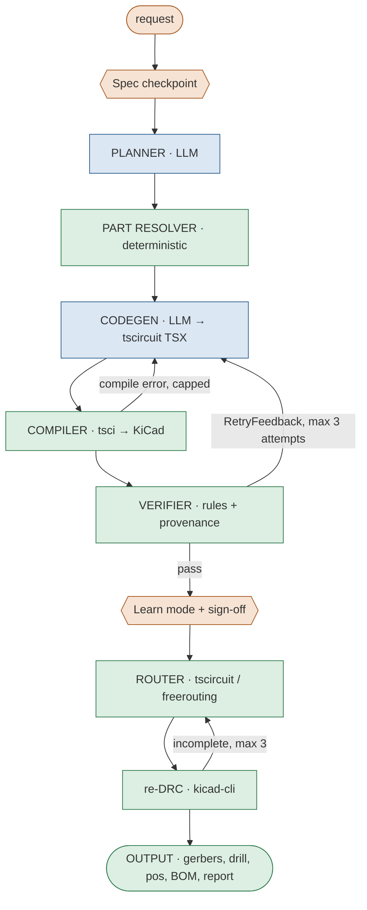

# 02 · Architecture

## Pipeline



Orange = human · blue = LLM · green = deterministic code.

## Stages

| # | Stage | Kind | Module | In → Out (see [04-contracts](04-contracts.md)) | Code owner |
|---|---|---|---|---|---|
| 0 | Spec checkpoint | human + LLM draft | `reflow/harness/` (planned) | request → `Spec` | prompt: HUMAN-approve · CLI: AGENT |
| 1 | Planner | LLM | `reflow/harness/` + `prompts/planner.md` | `Spec` → `Plan` | prompt: HUMAN-approve |
| 2 | Part resolver | deterministic | `reflow/parts/` | `Plan.parts` → `ResolvedParts` | catalog client: AGENT · validity/ranking: **HUMAN** |
| 3 | Codegen | LLM | `prompts/codegen.md`, `prompts/fix.md` | `Spec`+`Plan`+`ResolvedParts`(+`RetryFeedback`) → `GeneratedCode` | prompts: HUMAN-approve |
| 4 | Compiler | deterministic | `reflow/compile.py` | `GeneratedCode` → `CompileResult` | AGENT |
| 5 | Verifier | deterministic | `reflow/rules/`, `reflow/cli.py`, `cards/` | `circuit.json` + `PartCard`s (design) or KiCad schematic (check) → `VerifyReport` | rules, cards: **HUMAN** · loaders: AGENT |
| 6 | Feedback conversion | deterministic | `reflow/harness/` | `VerifyReport` / `CompileResult` → `RetryFeedback` | **HUMAN** |
| 7 | Harness loop | deterministic | `reflow/harness/` | everything above → `RunResult` | **HUMAN** (core loop, termination) · run-dir I/O: AGENT |
| 8 | Learn mode + sign-off | human | `reflow/learn/` (planned) | `RunResult` → `LearnRecord`, `SignOff` | selection logic: **HUMAN** · terminal UI: AGENT |
| 9 | Router | deterministic | `reflow/route.py`, `tools/bridges/` | `.kicad_pcb` → `RouteResult` | AGENT (scope rule: HUMAN) |
| 10 | Output | deterministic | `reflow/export.py` | routed board → `FabPackage` | AGENT |

## Where state lives

Every run writes a folder; nothing important lives only in memory.

```
runs/<YYYYmmdd-HHMMSS>-<slug>/
  run.json                    RunResult (rewritten after every step)
  spec.json   plan.json   parts.json
  attempts/01/
    prompt.md                 exactly what the model saw
    response.md               exactly what it returned
    index.circuit.tsx
    compile.json              CompileResult (one per compile try: compile-1.json, compile-2.json)
    verify.json               VerifyReport
    feedback.json             RetryFeedback sent to attempt 02
  learn.json   signoff.json
  route/      route.json  drc.json  board.kicad_pcb
  out/        gerbers/  board.drl  board-pos.csv  bom.csv  DESIGN.md  report.json
```

Runs go in `runs/`, which must be gitignored.

## Entry points

| Command | Status | What it does |
|---|---|---|
| `reflow check <board>` | built | Verifier only, on any KiCad schematic |
| `reflow design "<request>"` | planned (H-07) | Full pipeline above |
